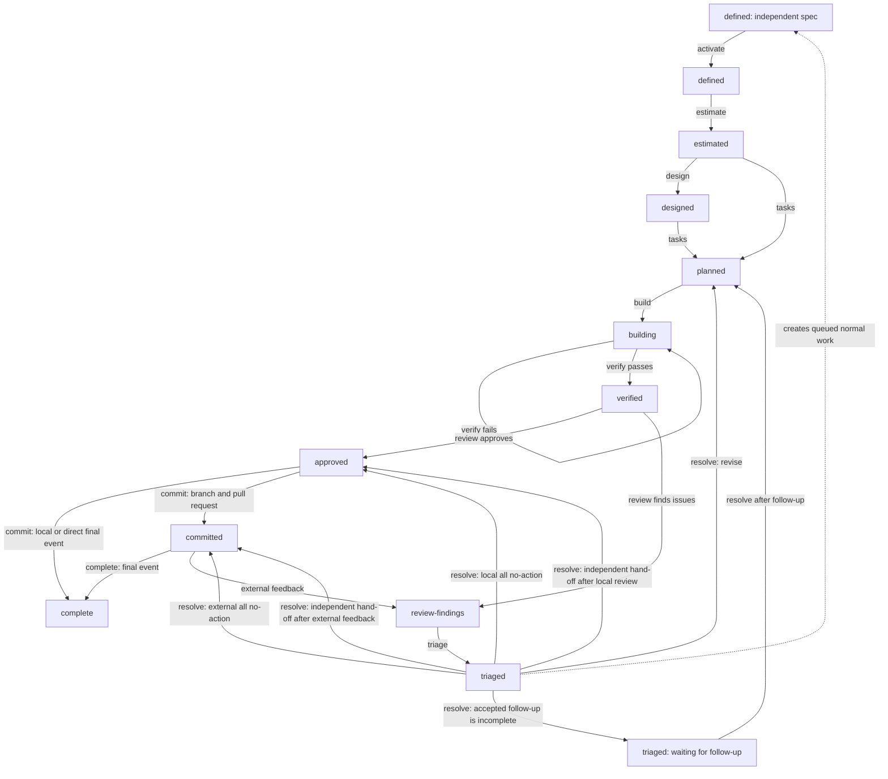
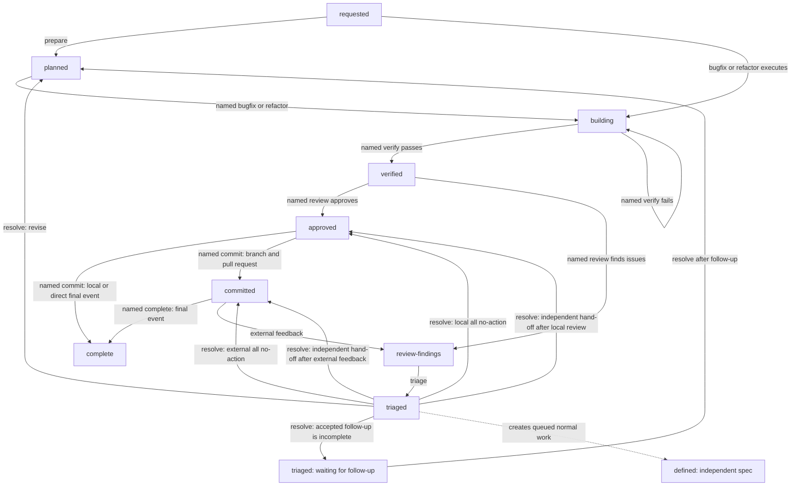
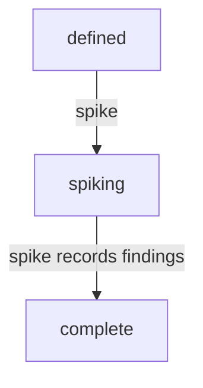

# Spec lifecycle

This is the lifecycle implemented by Specle today. It is a reference for the workflow skills and the state recorded in `.specle/context.json`; `.agents/steering/lifecycle.md` remains the authoritative policy.

Local approval and final delivery are distinct. `approved` records a passing local review; the selected project delivery policy determines whether `commit` completes the work directly or creates a submitted `committed` delivery for `complete` to finalise.

## Statuses

| Status | Meaning | Usual next workflow command |
| --- | --- | --- |
| `defined` | A work artefact exists but work has not begun. | `activate <spec-name>` for a queued normal change; its named abbreviated owner or `spike` otherwise. |
| `estimated` | Complexity has been assessed. | `design` or `tasks` |
| `designed` | Technical design exists. | `tasks` |
| `planned` | Tasks exist and implementation has not begun. | `build`, or named `bugfix` / `refactor` for abbreviated work |
| `building` | Implementation is in progress or incomplete. | `build` or named abbreviated workflow |
| `spiking` | A read-only investigation is in progress. | `spike` |
| `verified` | Current implementation and required quality gates passed. | `review` |
| `approved` | Local review passed; external delivery is not necessarily complete. | `commit` |
| `committed` | A branch-and-pull-request delivery awaits its configured final event. | `complete`, or named `triage` for external feedback |
| `review-findings` | Review has findings that need decisions. | `triage` |
| `triaged` | Every current finding has a recorded decision and routing is ready. | `resolve` |
| `complete` | The configured delivery outcome was confirmed, or a spike delivered its findings. | None |

`review.status` is separate from lifecycle status. It is `pass` after local approval and `resolved` when every current finding has a terminal no-action disposition or completed follow-up. Resolve returns a local no-action outcome to `approved` and a previously submitted no-action outcome to `committed`; neither outcome alone completes delivery.

## Workflow-command transitions

| Workflow command | Status transition |
| --- | --- |
| `spec` | Creates a queued normal spec as `defined`; it does not select or commence it. |
| `activate` | Promotes a named queued normal spec to current, then immediately starts its named `estimate` stage. |
| `estimate` | Marks the active target `estimated`; a named queued target changes only its own record. |
| `design` | Marks the active normal spec `designed`. |
| `tasks` | Marks the active normal spec `planned`. |
| `build` | Marks the active normal spec `building` while completing its tasks. A named committed normal target may be built in place without replacing the active issue. |
| `verify` | Sets a passing target `verified`; a failed target is `building`. A named committed normal target or queued abbreviated target changes only its own record. |
| `review` | On approval, sets the selected target `approved` with next `commit`. On findings, sets the selected target `review-findings`. |
| `commit` | Applies the selected delivery model: local-only and direct delivery may complete; branch-and-pull-request delivery becomes `committed`. |
| `complete` | Confirms the configured final event for committed branch-and-pull-request delivery. |
| `triage` | Sets a fully decided target `triaged`. |
| `resolve` | Reconciles previously dispatched accepted work, then dispatches any pending accepted follow-up. It reports `resolve <target>` as the later reconciliation step for incomplete follow-ups. A local no-action outcome returns to `approved`; a previously committed no-action outcome returns to `committed`. An independent-spec hand-off creates queued normal work and preserves the origin for its own delivery. |
| `revise` | Reconciles accepted feedback and returns an active normal spec to the earliest viable planning state; a named committed normal target becomes `planned` with `next: "build"`, and a named abbreviated item becomes queued `planned` with its owning next skill. |
| `prepare` | Creates a queued bugfix or refactor as `planned` with its owning next skill. |
| `bugfix` / `refactor` | When executed, move only the named abbreviated item to `building`; when called through `prepare`, they create artefacts without executing them. |
| `spike` | Moves an active spike through `defined` → `spiking` → `complete`. |

`analyse`, `context`, `specle`, `status`, `summary`, and `track` do not themselves transition lifecycle status. `summary` requires a completed target but does not alter it.

## Transition audit

Every non-terminal state has an owning workflow command and a valid next transition. `complete` is the only terminal state.

| State | Valid exit or terminal outcome | Audit result |
| --- | --- | --- |
| `defined` | `activate <spec-name>` commences a queued normal change; the named abbreviated owner or `spike` establishes the other paths. | Has an exit. |
| `estimated` | `design` or, for sufficiently small understood work, `tasks`. | Has an exit. |
| `designed` | `tasks`. | Has an exit. |
| `planned` | `build` for active normal work or named `bugfix` / `refactor` for queued abbreviated work. | Has an exit. |
| `building` | Further build work or `verify`. | Has an exit. |
| `spiking` | `spike` records findings and completes the investigation. | Has an exit. |
| `verified` | `review` either approves or creates review findings. | Has an exit. |
| `approved` | `commit` applies the selected delivery policy. | Has an exit. |
| `committed` | `complete` confirms delivery, or named `triage` handles external feedback. | Has an exit. |
| `review-findings` | `triage` records decisions. | Has an exit. |
| `triaged` | `resolve` dispatches pending actions, waits for incomplete follow-ups, creates queued independent work where required, restores a local no-action result to `approved`, or restores a submitted no-action result to `committed`. | Has an exit; no-action review and hand-off do not bypass delivery. |
| `complete` | Terminal. | Intentional terminal state. |

## Current flows

### Active normal work

### Queued abbreviated work: bugfix or refactor

### Active spike

Resolve preserves the active current issue for every explicitly named non-active target. `commit` or `complete` moves a target to `complete` only after its selected delivery policy's final event.
