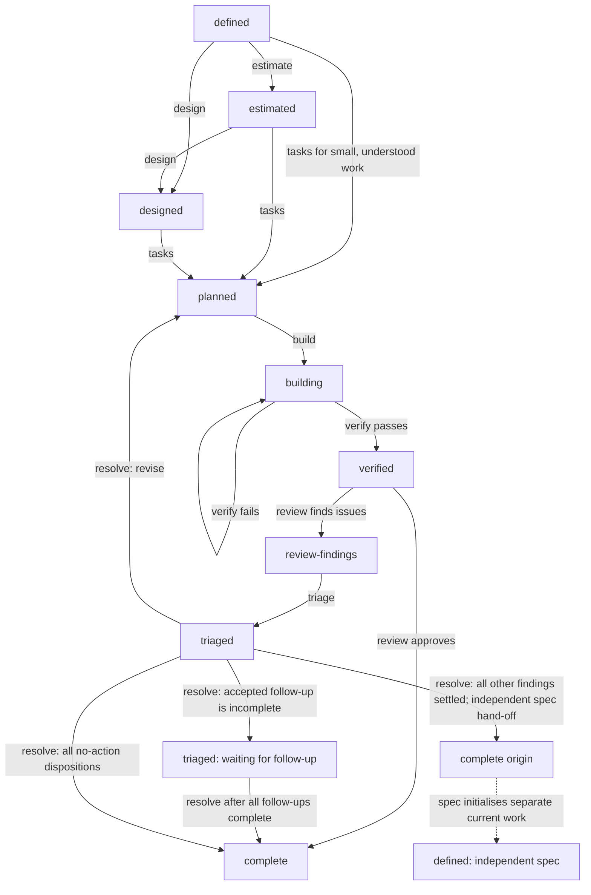
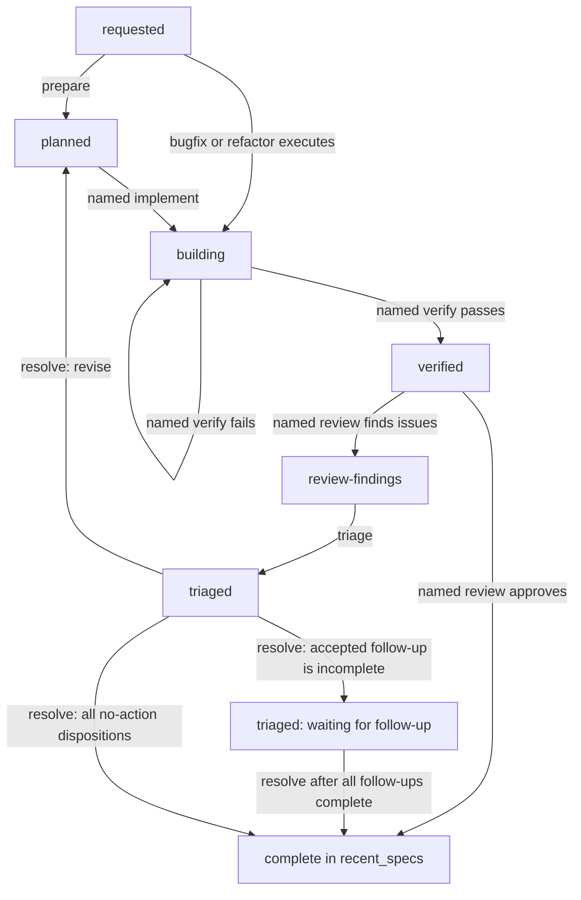
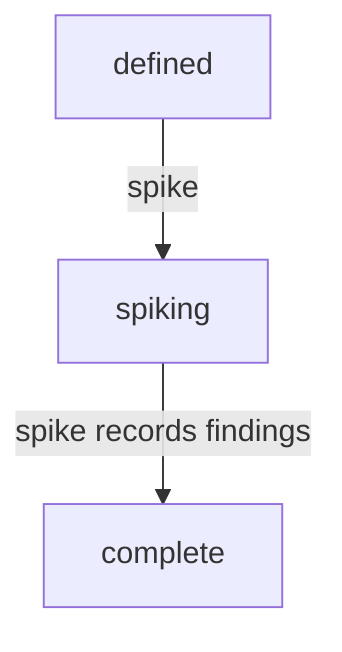

# Spec lifecycle

This is the lifecycle implemented by Specle today. It is a reference for the workflow skills and the state recorded in `.specle/context.json`; `.agents/steering/lifecycle.md` remains the authoritative policy.

It deliberately excludes the planned delivery-policy work, including `approved`, `committed`, `commit`, and `complete` workflow extensions that have not yet been implemented.

## Statuses

| Status | Meaning | Usual next workflow command |
| --- | --- | --- |
| `defined` | A work artefact exists but work has not begun. | `estimate`, `design`, `tasks`, or `spike` |
| `estimated` | Complexity has been assessed. | `design` or `tasks` |
| `designed` | Technical design exists. | `tasks` |
| `planned` | Tasks exist and implementation has not begun. | `build` or named `implement` |
| `building` | Implementation is in progress or incomplete. | `build` or named abbreviated workflow |
| `spiking` | A read-only investigation is in progress. | `spike` |
| `verified` | Current implementation and required quality gates passed. | `review` |
| `review-findings` | Review has findings that need decisions. | `triage` |
| `triaged` | Every current finding has a recorded decision and routing is ready. | `resolve` |
| `complete` | Work reached an implemented terminal path. | None |

`review.status` is separate from the lifecycle status. It is `pass` after a review approval and `resolved` when Resolve completes its selected target because every current finding is terminally no-action or has a completed dispatched follow-up.

## Workflow-command transitions

| Workflow command | Status transition |
| --- | --- |
| `spec` | Creates an active normal spec as `defined`. |
| `estimate` | Marks the active target `estimated`; a named queued target changes only its own record. |
| `design` | Marks the active normal spec `designed`. |
| `tasks` | Marks the active normal spec `planned`. |
| `build` | Marks the active normal spec `building` while completing its tasks. |
| `verify` | Sets a passing target `verified`; a failed target is `building`. A named queued abbreviated target changes only its queued record. |
| `review` | On approval, completes the active normal spec or moves an approved named abbreviated item to `recent_specs`. On findings, sets the selected target `review-findings`. |
| `triage` | Sets a fully decided target `triaged`. |
| `resolve` | Reconciles previously dispatched accepted work, then dispatches any pending accepted follow-up. It reports `resolve <target>` as the later reconciliation step for incomplete follow-ups. An independent `spec` route is a terminal hand-off only once every other finding is settled; then Resolve completes the active normal origin before initialising the new current spec. |
| `revise` | Reconciles accepted feedback and returns an active normal spec to the earliest viable planning state; a named abbreviated item becomes queued `planned` with `next: "implement"`. |
| `prepare` | Creates a queued bugfix or refactor as `planned` with `next: "implement"`. |
| `bugfix` / `refactor` | When executed, move only the named abbreviated item to `building`; when called through `prepare`, they create artefacts without executing them. |
| `spike` | Moves an active spike through `defined` → `spiking` → `complete`. |
| `implement` | Orchestrates the missing normal stages or a named abbreviated workflow; the delegated skill owns each status transition. |

`analyse`, `context`, `specle`, `status`, `summary`, and `track` do not themselves transition lifecycle status. `summary` requires a completed target but does not alter it.

## Transition audit

Every non-terminal state has an owning workflow command and a valid next transition. `complete` is the only terminal state.

| State | Valid exit or terminal outcome | Audit result |
| --- | --- | --- |
| `defined` | `estimate`, `design`, `tasks`, or `spike` establishes the next stage. | Has an exit. |
| `estimated` | `design` or, for sufficiently small understood work, `tasks`. | Has an exit. |
| `designed` | `tasks`. | Has an exit. |
| `planned` | `build` for active normal work or named `implement` for queued abbreviated work. | Has an exit. |
| `building` | Further build work or `verify`. | Has an exit. |
| `spiking` | `spike` records findings and completes the investigation. | Has an exit. |
| `verified` | `review` either approves or creates review findings. | Has an exit. |
| `review-findings` | `triage` records decisions. | Has an exit. |
| `triaged` | `resolve` dispatches pending actions, waits for incomplete follow-ups, completes once all findings are settled, or terminally hands off an independent normal spec once every other finding is settled. | Has an exit; independent normal work does not create a queued-normal dead end or bypass accepted work. |
| `complete` | Terminal. | Intentional terminal state. |

## Current flows

### Active normal work

### Queued abbreviated work: bugfix or refactor

### Active spike

Resolve completes an active normal target in place. For a named queued bugfix or refactor, it moves only that completed record to `recent_specs`, preserving the active current issue.
