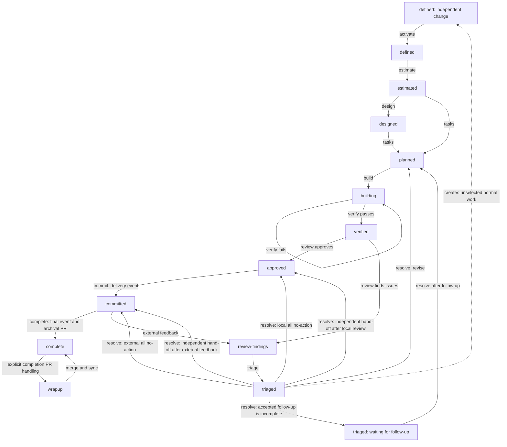
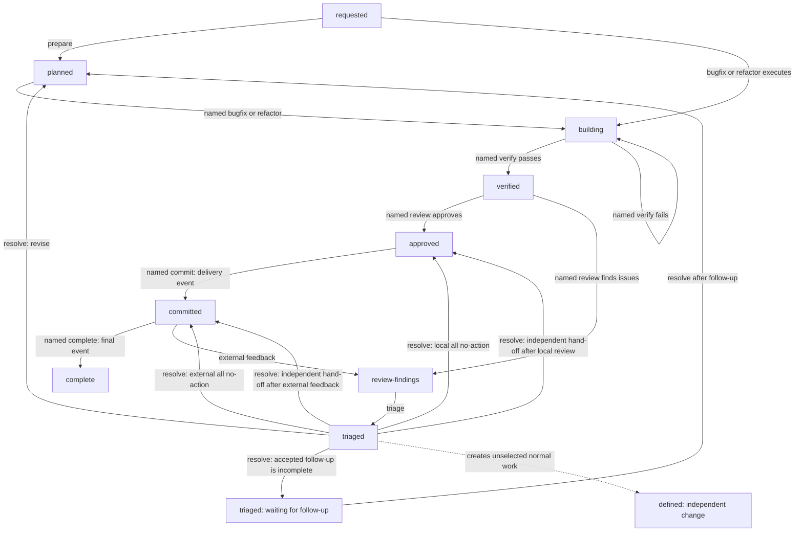
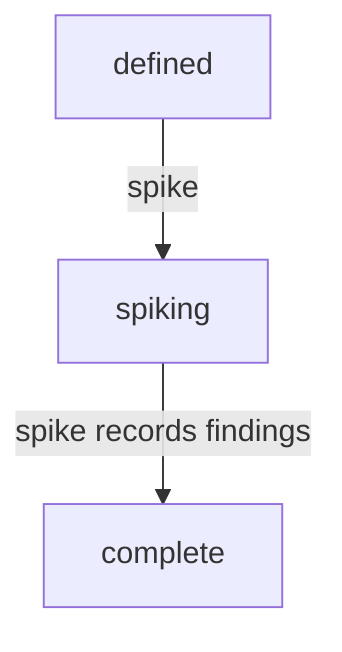

# Change lifecycle

This is the lifecycle implemented by Specle today. It is a reference for the workflow skills and the per-change state recorded in `.specle/changes/<name>/status.json` or `.specle/archive/<name>/status.json`; `.agents/policies/lifecycle.md` remains the authoritative package policy and project steering may refine it.

Local approval, delivery, and archival finalisation are distinct. `approved` records a passing local review; `commit` records the applicable delivery event and moves work to `committed`; `complete` records completion and archives the durable change record. A completion PR, when required, is retained as immutable identity and `wrapup` may inspect, merge, and synchronise it when explicitly invoked.

## Statuses

| Status | Meaning | Usual next workflow command |
| --- | --- | --- |
| `defined` | A work artifact exists but work has not begun. | `activate <change-name>` for an unselected normal change; its named abbreviated owner or `spike` otherwise. |
| `estimated` | Complexity has been assessed. | `design` or `tasks` |
| `designed` | Technical design exists. | `tasks` |
| `planned` | Tasks exist and implementation has not begun. | `build`, or named `bugfix` / `refactor` for abbreviated work |
| `building` | Implementation is in progress or incomplete. | `build` or named abbreviated workflow |
| `spiking` | A read-only investigation is in progress. | `spike` |
| `verified` | Current implementation and required quality gates passed. | `review` |
| `approved` | Local review passed; external delivery is not necessarily complete. | `commit` |
| `committed` | A delivery event was recorded and archival finalisation remains. | `complete`, or named `triage` for external feedback |
| `review-findings` | Review has findings that need decisions. | `triage` |
| `triaged` | Every current finding has a recorded decision and routing is ready. | `resolve` |
| `complete` | The configured delivery outcome was confirmed, or a spike delivered its findings. | None; `wrapup <change-name>` may be explicitly invoked to inspect a recorded completion PR. |

`review.status` is separate from lifecycle status. It is `pass` after local approval and `resolved` when every current finding has a terminal no-action disposition or completed follow-up. Resolve returns a local no-action outcome to `approved` and a previously submitted no-action outcome to `committed`; neither outcome alone completes delivery.

## Workflow-command transitions

| Workflow command | Status transition |
| --- | --- |
| `define` | Creates an unselected normal change as `defined`, reports its concise summary, and does not select or commence it. |
| `activate` | The sole workflow writer of ignored local `current-change`. It selects a resumable normal change or a spike, fills a normal change's required estimate → design → tasks preparation chain before invoking build, and invokes a selected spike. |
| `estimate` | Marks the selected target `estimated`; selected normal work continues to design, while a named unselected target writes only its advisory estimate and remains unselected. |
| `design` | Marks the selected normal change `designed`; a named unselected target writes only its design and remains unselected. |
| `tasks` | Requires a design. Marks the selected normal change `planned`; a named unselected target writes only its task plan and remains unselected. |
| `build` | For a planned normal change, first presents a specification alignment summary and requires explicit confirmation before implementation, including in decision-gated progression. It then marks the selected normal change `building` while completing its tasks. A named committed normal target may be built in place without replacing the local selection. |
| `verify` | Sets a passing target `verified`; a failed target is `building`. A named committed normal target or unselected abbreviated target changes only its own record. |
| `review` | On approval, sets the selected target `approved` with next `commit`. On findings, sets the selected target `review-findings`. |
| `commit` | Applies the selected delivery model, records its delivery event and `updated_at`, and moves every delivered member to `committed`. A normal parent may include only sidecars it declares with concurrent delivery and that reciprocally agree and are ready; it never infers them from a reverse scan. An explicitly selected archived completion record may instead commit only its triage findings and resolved related sidecars to its existing completion branch. |
| `complete` | Confirms the configured final event when necessary, removes the delivered parent and eligible reciprocal sidecars from matching explicit dependency arrays in other active records, generates the parent summary, writes `complete` and `archived_at`, then performs authorised recoverable archival finalisation. A parent archives every eligible reciprocal committed sidecar in the same mutation and completion PR. It includes the dependency-record updates in that finalisation commit, creates or identifies one required completion PR, and records its evidence on every jointly archived record in a follow-up commit on that same branch while retaining the selector. Direct delivery without a completion PR clears the matching selector. |
| `wrapup` | Merges the recorded archival completion PR, synchronises the delivery branch, and clears the matching parent selector without changing archived records. One completion PR finalises the parent and all jointly archived sidecars. |
| `triage` | Sets a fully decided active target `triaged`. An explicitly named archived completion record with recorded completion PR identity may change only `review-findings.json`. |
| `resolve` | Reconciles previously dispatched accepted work, then dispatches any pending accepted follow-up. It reports `resolve <target>` as the later reconciliation step for incomplete follow-ups. A local no-action outcome returns to `approved`; a previously committed no-action outcome returns to `committed`. Archived completion triage creates only related bugfix or refactor sidecars and preserves the archive. |
| `revise` | Reconciles accepted feedback and returns eligible active work to the earliest viable planning state; archived records are immutable. |
| `prepare` | Creates an unselected bugfix or refactor as `planned` with its owning next skill. |
| `bugfix` / `refactor` | When executed, move only the named abbreviated item to `building`; when called through `prepare`, they create artifacts without executing them. |
| `spike` | Creates an unselected spike or, when invoked by `activate`, moves it through `defined` → `spiking` → `complete` while recording durable findings and a stable outcome-change name. |

`analyse`, `specle`, `changelist`, `status`, `summary`, and `track` do not themselves transition lifecycle status. `changelist` inventories pending and dependency-context work, while `status` reports the selected active or archived change and compact local worktree state. `summary` requires a completed target but does not alter it.

## Transition audit

Every non-terminal state has an owning workflow command and a valid next transition. `complete` is the only terminal state.

| State | Valid exit or terminal outcome | Audit result |
| --- | --- | --- |
| `defined` | `activate <change-name>` commences an unselected normal change; the named abbreviated owner or `spike` establishes the other paths. | Has an exit. |
| `estimated` | `design` or, for sufficiently small understood work, `tasks`. | Has an exit. |
| `designed` | `tasks`. | Has an exit. |
| `planned` | `build` for selected normal work or named `bugfix` / `refactor` for unselected abbreviated work. | Has an exit. |
| `building` | Further build work or `verify`. | Has an exit. |
| `spiking` | `spike` records findings and completes the investigation. | Has an exit. |
| `verified` | `review` either approves or creates review findings. | Has an exit. |
| `approved` | `commit` applies the selected delivery policy. | Has an exit. |
| `committed` | `complete` archives delivery, or named `triage` handles external feedback. | Has an exit. |
| `review-findings` | `triage` records decisions. | Has an exit. |
| `triaged` | `resolve` dispatches pending actions, waits for incomplete follow-ups, creates unselected independent work where required, restores a local no-action result to `approved`, or restores a submitted no-action result to `committed`. | Has an exit; no-action review and hand-off do not bypass delivery. |
| `complete` | Terminal, except for the conditional archival completion-PR delivery owned by `wrapup`. | Intentional terminal state with a conditional final delivery action. |

## Current flows

### Active normal work

### Unselected abbreviated work: bugfix or refactor

### Active spike

Resolve preserves `.specle/current-change` for every explicitly named non-selected target. `complete` archives a target only after its selected delivery policy's final event and retains its selector until `wrapup` merges the recorded completion PR. During explicit external-feedback triage for an archived completion PR, the archive remains read-only except for `review-findings.json`; accepted corrective work is delivered as named related bugfix or refactor sidecars on the same completion branch.

## Concurrent sidecars

Concurrent bugfixes and refactors are explicit, reciprocal delivery members rather than inferred work. The parent `status.json` names each sidecar with `type: "bugfix"` or `"refactor"` and `delivery: "with-related-change"`; the sidecar names the parent with `type: "origin"` and the same delivery value. Creation records both sides together. For commit and completion, the parent is the only candidate source, and every candidate must have exactly one matching reciprocal active record in the required lifecycle state. A missing, mismatched, duplicate, or unready declaration stops joint delivery with a diagnostic. Valid sidecars receive the shared delivery and completion evidence, archive with the parent, and are finalised by the same `wrapup`; they never receive a separate completion cycle.
