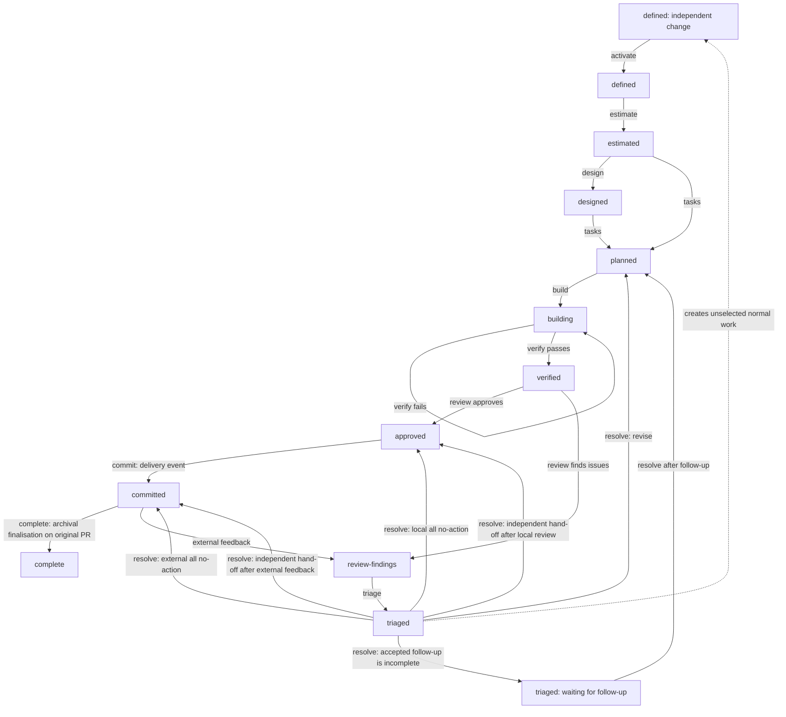
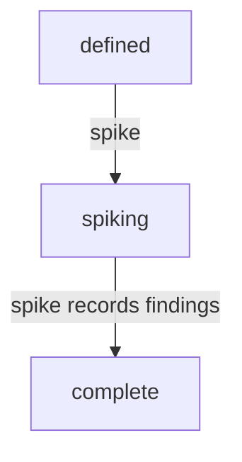

# Change lifecycle

This is the lifecycle implemented by Specle today. It is a reference for the workflow skills and the per-change state recorded in `.specle/changes/<name>/status.json` or `.specle/archive/<name>/status.json`; `.agents/policies/lifecycle.md` remains the authoritative package policy and project steering may refine it.

Local approval, delivery, and archival finalisation are distinct. `approved` records a passing local review; `commit` records the applicable delivery event and moves work to `committed`; `complete` records completion and archives the durable change record on the same delivery path. For branch delivery it records immutable PR identity on the original PR, requests auto-merge where permitted, and later synchronises after that PR merges. A `<delivery-branch>-complete` PR is recovery only when the original PR merged before archival delivery.

`cancel <change-name>` is the separate terminal path for ending one explicitly named active change without asserting delivery. It first presents direct dependencies, every explicitly reciprocal concurrent-delivery partner, and in-flight checkout, direct-delivery, or PR consequences. It requires the user's separate confirmation for dependency removal or each reciprocal unlink, and their direction for cleanup before recording `cancelled` and archiving the record.

## Statuses

| Status | Meaning | Usual next workflow command |
| --- | --- | --- |
| `defined` | A work artifact exists but work has not begun. | `activate <change-name>` for an unselected normal change; its named abbreviated owner or `spike` otherwise. |
| `estimated` | Complexity has been assessed. | `design` or `tasks` |
| `designed` | Technical design exists. | `tasks` |
| `planned` | Tasks exist and implementation has not begun. | `build`, or named `bugfix` / `refactor` for abbreviated work |
| `building` | Implementation is in progress or incomplete. | `build` or named abbreviated workflow |
| `spiking` | A read-only investigation is in progress. | `spike` |
| `verified` | Current implementation and required quality gates passed. | `review` |
| `approved` | Local review passed; external delivery is not necessarily complete. | `commit` |
| `committed` | A delivery event was recorded and archival finalisation remains. | `complete`, or named `triage` for external feedback |
| `review-findings` | Review has findings that need decisions. | `triage` |
| `triaged` | Every current finding has a recorded decision and routing is ready. | `resolve` |
| `complete` | Archival finalisation was recorded on the existing delivery path, or a spike delivered its findings. | None; a named `complete <change-name>` may later synchronise after the original or recovery PR merges. |
| `cancelled` | Work intentionally ended without asserting delivery. | None; the archived record is immutable. |

`review.status` is separate from lifecycle status. It is `pass` after local approval and `resolved` when every current finding has a terminal no-action disposition or completed follow-up. Resolve returns a local no-action outcome to `approved` and a previously submitted no-action outcome to `committed`; neither outcome alone completes delivery.

## Workflow-command transitions

| Workflow command | Status transition |
| --- | --- |
| `define` | Creates an unselected normal change as `defined`, reports its concise summary, and does not select or commence it. |
| `activate` | The sole workflow writer of ignored local `current-change`. It selects a resumable normal change or a spike, fills a normal change's required estimate → design → tasks preparation chain before invoking build, and invokes a selected spike. |
| `estimate` | Marks the selected target `estimated`; selected normal work continues to design, while a named unselected target writes only its advisory estimate and remains unselected. |
| `design` | Marks the selected normal change `designed`; a named unselected target writes only its design and remains unselected. |
| `tasks` | Requires a design. Marks the selected normal change `planned`; a named unselected target writes only its task plan and remains unselected. |
| `build` | For a planned normal change, first presents a specification alignment summary and requires explicit confirmation before implementation, including in decision-gated progression. It then marks the selected normal change `building` while completing its tasks. A named committed normal target may be built in place without replacing the local selection. |
| `verify` | Sets a passing target `verified`; a failed target is `building`. A named committed normal target or unselected abbreviated target changes only its own record. |
| `review` | On approval, sets the selected target `approved` with next `commit`. On findings, sets the selected target `review-findings`. |
| `commit` | Applies the selected delivery model, records its delivery event and `updated_at`, and moves every delivered member to `committed`. A normal parent may include only sidecars it declares with concurrent delivery and that reciprocally agree and are ready; it never infers them from a reverse scan. |
| `complete` | Removes the delivered parent and eligible reciprocal sidecars from matching explicit dependency arrays in other active records, generates the parent summary, writes `complete`, `archived_at`, and immutable `delivery.completion` PR identity, then performs recoverable archival finalisation. For branch delivery it pushes this mutation to the original PR and requests auto-merge; only an original PR already merged before archival delivery creates a recovery PR. A later `complete` synchronises after merge. Direct delivery writes no completion object, pushes the archival finalisation, and clears the matching selector. |
| `cancel` | Requires an explicit active target name. It presents direct dependents, explicitly reciprocal concurrent-delivery partners, and user-owned in-flight work; requires separate confirmation before removing direct dependency entries or unlinking each partner; then writes `cancelled` and `cancelled_at`, archives the named record, and clears only a matching selector. It does not perform cleanup, delivery, or external actions without separate direction and authorisation. |
| `triage` | Sets a fully decided active target `triaged`. Archived records are immutable and do not enter triage. |
| `resolve` | Reconciles previously dispatched accepted work, then dispatches any pending accepted follow-up. It reports `resolve <target>` as the later reconciliation step for incomplete follow-ups. A local no-action outcome returns to `approved`; a previously committed no-action outcome returns to `committed`. |
| `revise` | Reconciles accepted feedback and returns eligible active work to the earliest viable planning state. Archived records are immutable; a later defect requires independent work. |
| `prepare` | Creates an unselected bugfix or refactor as `planned` with its owning next skill. |
| `bugfix` / `refactor` | When executed, move only the named abbreviated item to `building`; when called through `prepare`, they create artifacts without executing them. |
| `spike` | Creates an unselected spike or, when invoked by `activate`, moves it through `defined` → `spiking` → `complete` while recording durable findings and a stable outcome-change name. |

`analyse`, `specle`, `changes`, `status`, `summary`, and `track` do not themselves transition lifecycle status. `changes` inventories pending and dependency-context work, while `status` reports the selected active or archived change and compact local worktree state. `summary` requires a completed target but does not alter it.

## Transition audit

Every non-terminal state has an owning workflow command and a valid next transition. `complete` and `cancelled` are terminal states with distinct meanings.

| State | Valid exit or terminal outcome | Audit result |
| --- | --- | --- |
| `defined` | `activate <change-name>` commences an unselected normal change; the named abbreviated owner or `spike` establishes the other paths. | Has an exit. |
| `estimated` | `design` or, for sufficiently small understood work, `tasks`. | Has an exit. |
| `designed` | `tasks`. | Has an exit. |
| `planned` | `build` for selected normal work or named `bugfix` / `refactor` for unselected abbreviated work. | Has an exit. |
| `building` | Further build work or `verify`. | Has an exit. |
| `spiking` | `spike` records findings and completes the investigation. | Has an exit. |
| `verified` | `review` either approves or creates review findings. | Has an exit. |
| `approved` | `commit` applies the selected delivery policy. | Has an exit. |
| `committed` | `complete` archives delivery, or named `triage` handles external feedback. | Has an exit. |
| `review-findings` | `triage` records decisions. | Has an exit. |
| `triaged` | `resolve` dispatches pending actions, waits for incomplete follow-ups, creates unselected independent work where required, restores a local no-action result to `approved`, or restores a submitted no-action result to `committed`. | Has an exit; no-action review and hand-off do not bypass delivery. |
| `complete` | Terminal. A later named `complete` may inspect the original or recovery PR and synchronise after merge. | Intentional terminal state. |
| `cancelled` | Terminal. | Intentional terminal state; it does not assert delivery. |

## Current flows

### Active normal work

Branch archival finalisation stays on the original delivery PR and is pushed before final merge, so the state graph needs no second completion command. If that PR was already merged before archival delivery, completion stops its normal path and uses a recoverable `<delivery-branch>-complete` PR instead. Completion requires the checkout to be on the current original or recovery phase branch; it reports a mismatch rather than switching or stashing automatically.

### Unselected abbreviated work: bugfix or refactor

### Active spike

Resolve preserves `.specle/current-change` for every explicitly named non-selected target. `complete` archives a branch-delivery target on its original open PR and retains its selector until a later `complete` confirms that PR merged and synchronises the delivery branch. External feedback is settled through the normal committed-work triage loop before archival finalisation. Once archived, the record is immutable; a later defect requires independent work.

At any active non-terminal status, `cancel <change-name>` is available as an explicit alternative. It never infers the target from the selector. Existing worktree content is always presented as user-owned and unattributed; no reset, stash, branch action, commit, push, or PR action occurs without explicit user direction.

## Concurrent sidecars

Concurrent bugfixes and refactors are explicit, reciprocal delivery members rather than inferred work. The parent `status.json` names each sidecar with `type: "bugfix"` or `"refactor"` and `delivery: "with-related-change"`; the sidecar names the parent with `type: "origin"` and the same delivery value. Creation records both sides together. For commit and completion, the parent is the only candidate source, and every candidate must have exactly one matching reciprocal active record in the required lifecycle state. A missing, mismatched, duplicate, or unready declaration stops joint delivery with a diagnostic. Valid sidecars receive the shared delivery and completion evidence, archive with the parent, and have no separate completion cycle.
